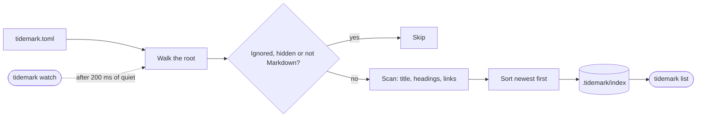
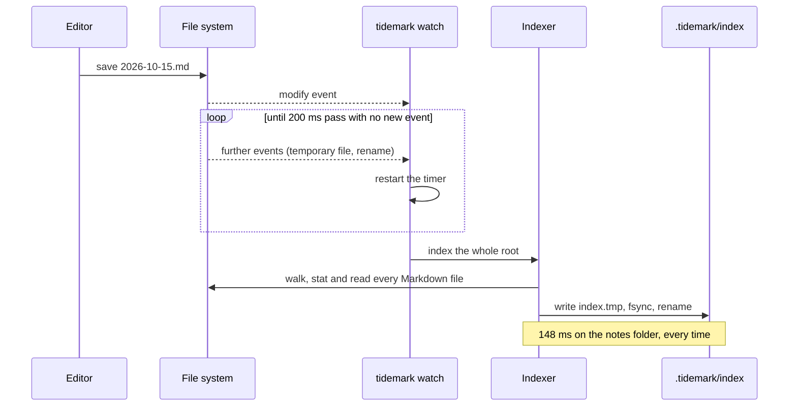

# How tidemark works

tidemark does one thing: it walks a folder, reads the Markdown files in it, and writes a small index of what it found into `.tidemark/` at the top of that folder. This page describes 0.4.0, released on 9 October. It is written for someone about to change the code, so it names files and says why things are the way they are. Settings are covered in [Configuration](config.md); the proposal to stop re-reading unchanged files is in [Incremental indexing](specs/incremental-indexing.md).

There are four parts, each in its own file:

- the walk, in `src/walk.rs`, which decides which files to look at;
- the parser, in `src/parse.rs`, which reads one file and returns an entry;
- the index file, in `src/index/format.rs`, which writes the entries to disk;
- the watcher, in `src/watch.rs`, which runs the other three again when something changes.



## The walk

The walk starts at the root, which is the path given on the command line, or `root` from `tidemark.toml`, or the current folder. It uses the `ignore` crate, the same walker ripgrep uses, so it honours `.gitignore`, `.ignore` and git's global excludes file, and skips hidden files and folders. One setting differs from the crate's defaults: `.gitignore` rules apply even when the folder is not a git repository.[^1] Symbolic links are not followed, so a link to a large folder elsewhere on the disk cannot pull the whole of it into the index.

Skipping hidden folders is what keeps the walk out of `.tidemark/` itself, and out of `.git` and `.obsidian`. A file counts as Markdown if its extension is `.md` or `.markdown`; everything else is visited and dropped, which is why the walk reports paths and Markdown files separately. On the notes folder it visits 1,412 paths, of which 1,203 are Markdown.

The ignore check is the most important line in the program. A refactor in early October removed it, and the next run on the notes folder walked into a single JavaScript project's `node_modules`, visited about 180,000 files instead of 1,400, and took 9 seconds. The check is back at `src/walk.rs:142`, and a test now builds a folder containing a 10,000-file `node_modules` and fails if indexing it takes longer than 100 ms.

## The parser

The parser is deliberately a line scanner, not a CommonMark parser. It keeps track of two things as it goes, whether it is inside front matter and whether it is inside a fenced code block, and ignores everything else about the structure of the document. A full parse would cost about four times as much per file, and the index needs none of what it would add.

| What | Where it comes from | Notes |
| :--- | :--- | :--- |
| Title | `title` in the front matter, else the first heading, else the file name | Used by `tidemark list` |
| Headings | ATX headings (`#` to `######`) and setext headings | Never inside a fenced block; trailing `#` marks dropped since 0.4.0 |
| Links | Inline links and `[[wikilinks]]` with a relative target | Links with a scheme, such as `https:`, are skipped |
| Tags | `tags` in the front matter | Inline `#tags` are not read yet |
| Modified time | The file system | Decides the order, newest first |

Fenced blocks matter because a shell snippet is full of lines that start with `#`. Before the scanner tracked fences, a note containing a script would list its comments as headings. The heading rule itself follows CommonMark closely enough for notes:

```rust
/// The level and text of an ATX heading, or `None` if the line is not one.
/// `## Notes ##` gives `(2, "Notes")`; `## Notes on C#` keeps its `#`;
/// `#tidemark` is a tag, not a heading.
fn atx_heading(line: &str) -> Option<(u8, &str)> {
    let level = line.bytes().take_while(|&b| b == b'#').count();
    if level == 0 || level > 6 {
        return None;
    }
    let rest = &line[level..];
    if !rest.is_empty() && !rest.starts_with(char::is_whitespace) {
        return None;
    }
    let text = rest.trim();
    let text = match text.trim_end_matches('#') {
        "" => "",
        t if t.ends_with(char::is_whitespace) => t.trim_end(),
        _ => text,
    };
    Some((level as u8, text))
}
```

The closing run of `#` marks is removed only when a space comes before it. That is the 0.4.0 fix for headings like `## like this ##`, and it is also why `C#` survives. Lines longer than 64 KiB are not scanned for headings at all.[^2]

## The index file

The index lives at `.tidemark/index`, beside the files it describes, for the reasons in [ADR 0004](adr/0004-keep-the-index-beside-the-files.md). In 0.4.0 it is format version 2: a header that starts with the four bytes `TDMK`, a table of fixed-size entries, and a string table holding paths, titles, headings and links. Each entry costs about 200 bytes, so the notes folder's index is about 245 KB.

The file is always written whole. tidemark writes `.tidemark/index.tmp`, calls `fsync`, and renames it over the old index. The rename is atomic on every file system tidemark supports, so anything reading the index sees either the old version or the new one and never a mixture. On its first run tidemark also writes `.tidemark/.gitignore` containing a single `*`, so a folder that is a repository ignores the index without anyone editing their own `.gitignore`.

Entries are stored newest first, which is the order `tidemark list` prints them in. Sorting is the only step whose cost grows faster than the number of files, and at 1,203 entries it takes well under a millisecond.

## Watch

`tidemark watch` keeps the index current while you work. It subscribes to file events through the `notify` crate, which uses inotify on Linux, FSEvents on macOS and `ReadDirectoryChangesW` on Windows, and waits for a burst of events to settle before it does anything. Editors rarely save with a single write: most write a temporary file and rename it into place, and some touch a swap file as well, so one save can produce four or five events.



The wait is 200 ms by default and can be changed with `--debounce`. Only one run happens at a time; events that arrive during a run start the next timer rather than a second run.

When the timer expires, the watcher does not work out what changed. It runs the whole indexer again, exactly as `tidemark index` would. On the notes folder that is 148 ms, which nobody notices. On a folder of 38,000 notes it is over four seconds of one core for every save, and that is the problem the [incremental indexing spec](specs/incremental-indexing.md) sets out to solve.

> [!TIP]
> `tidemark index --stats` prints how long the walk, the parse and the write each took. If the walk dominates, look for a large folder that no `.gitignore` covers. That was the whole of the October regression, and it is the first thing to check whenever a run feels slow.

[^1]: The crate's default is to apply `.gitignore` only inside a git repository. tidemark turns that off with `require_git(false)`, because a notes folder is usually not a repository, but a `.gitignore` someone has put in it still says what they want left out.

[^2]: Before 0.3.2, a file that was one very long line, such as minified JSON saved with a `.md` extension, could crash the scanner. The cap keeps the cost of such a file down to reading it once.
