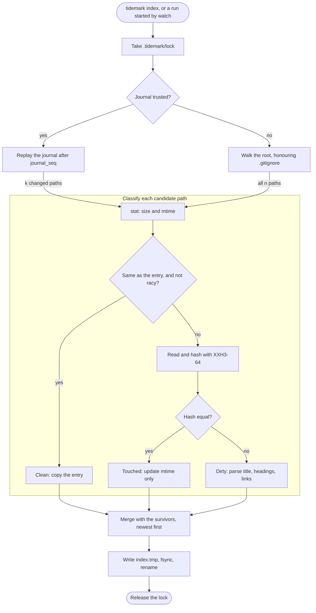
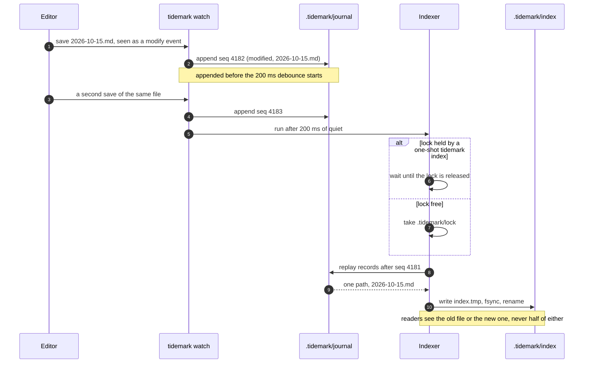

# Incremental indexing: re-read only what changed

This spec proposes that `tidemark index` stop re-reading every file on every run, and that `tidemark watch` tell it which files changed. It was drafted from the prototype on the `incremental` branch (at `a3f9c21`), Hannah's notes from the 13 October sync, and the measurements below. The decisions that need a reviewer are collected under [Open questions](#open-questions).

## TL;DR

- `tidemark index` keeps an entry from the previous index whenever the file's size and modification time are unchanged, and re-parses a file only when its content hash differs.
- `tidemark watch` appends every change it sees to a journal, `.tidemark/journal`, so the next run starts from a list of changed paths instead of walking the whole tree.
- The index file moves to format version 3, which stores each file's size and content hash and records which journal entries it has seen. 0.5.0 reads version 2 and rewrites it on the first run.
- With nothing changed, a run on the 10,000-file corpus drops from 1.04 s to 118 ms; under `tidemark watch`, one save in a 100,000-file folder is indexed in 74 ms instead of 11.3 s. It ships off by default in 0.5.0.

## Context: why tidemark re-reads every file on every save, and why that has stopped being fine

Today the indexer is a pure function of the folder; [How tidemark works](../architecture.md) describes it in full. It walks the root, honouring `.gitignore`, reads every Markdown file, extracts the title, headings and links, sorts the entries newest first and writes `.tidemark/index` from scratch. `tidemark watch` calls the same function after each burst of file events settles, so a single save costs a full walk and a full parse.

That was the right design for the folders tidemark was written for. On the author's notes folder (1,203 Markdown files among 1,412 paths walked) a full run takes 148 ms, below the point where anyone notices. The regression of 8 October, when the walk lost its ignore check and a run took 9 seconds,[^1] showed how quickly the cost grows with the number of paths visited. Once the check was restored at `src/walk.rs:142`, the number went back to where it had been.

Two reports since 0.4.0 shipped on 9 October have come from larger folders. One is a vault of about 38,000 notes, where every save under `tidemark watch` costs a little over four seconds of one core. The other is a documentation monorepo, where the watcher's runs queue up behind each other whenever someone switches branches. In both cases the work is wasted: nearly every file read on a given run is byte for byte what was read on the run before.

## Goals

1. A run in which nothing has changed should cost a walk and a comparison, not a read of every file.
2. Under `tidemark watch`, the cost of a save should be proportional to what was saved, not to the size of the folder.
3. The index must never be wrong in a way that a full rebuild would fix. Where the fast path cannot be sure, it takes the slow one.
4. Keep the promise in the [README](../../README.md): tidemark writes nothing outside the folder you give it. All new state lives in `.tidemark/`, as [ADR 0004](../adr/0004-keep-the-index-beside-the-files.md) requires.

## Non-goals

- Making the first run faster. A folder with no index is read in full, and this change makes that run about 6% slower, because it now hashes as it reads.
- A daemon. `tidemark watch` stays a foreground process that somebody started; nothing runs at login.
- Partial writes to the index file. The file is still written whole and renamed into place; appending is discussed under [Alternatives considered](#alternatives-considered).
- Windows paths. That question is open for 1.0 and is not settled here.

## Design

### The indexing pipeline after this change



Every path reaches the same classification step, whichever way it arrived. The journal only shortens the list of candidates; it never decides by itself that a file is unchanged.

### The change journal

#### What gets recorded

`tidemark watch` already receives an event for every change under the root. With this change it appends one record per event to `.tidemark/journal` before it starts its debounce timer. A record holds a sequence number, the kind of change, the path relative to the root with `/` separators, and a CRC-32 of the rest of the record. The byte layout is in Appendix A.

Paths that the walk would ignore are dropped before they are written, so an `npm install` in a project inside the notes folder does not fill the journal with `node_modules`. The watcher compiles the ignore rules when it starts and again whenever a `.gitignore` under the root changes. That change is itself recorded, as a record of kind `rescan`, because it can alter which files belong in the index without touching any of them.

The prototype's replay is `Journal::replay`, at `src/index/journal.rs:88-120`. It reads the records after the sequence number stored in the index header, stops at the first record whose CRC does not match, and returns the paths in the order first seen, with repeated events for one path collapsed into one.

#### When the journal is trusted

A run trusts the journal only when all of these hold:

- the sequence number in the index header is still present in the journal, so nothing the index has not seen was compacted away;
- no `overflow` record follows it, which the watcher writes when the operating system reports that it dropped events;[^4]
- no `rescan` record follows it;
- the watcher that wrote it is still running. The watcher holds an advisory lock on the journal for its whole life, and a run that can take that lock knows that nobody is watching and that changes may have gone unrecorded.

A one-shot `tidemark index` with no watcher running therefore always walks. So does every fiftieth generation, whatever the journal says, as a scrub.

> [!IMPORTANT]
> The journal is a hint about where to look, never a record of what is true. If any condition above fails, the run walks the whole root exactly as 0.4.0 does and classifies every path by size, modification time and hash. A bug in the journal can make a run slower. It must not be able to make the index wrong.

#### Compaction

The indexer never modifies the journal. It writes the last sequence number it folded in to the index header, and the watcher, which is the journal's only writer, compacts the file when more than half of it lies before that point: it copies the tail to `journal.tmp` between two appends and renames it over the original. In a week of ordinary use on the notes folder the journal never grew past 14 KB.

### Hashing, and why a changed modification time is not reason enough to re-parse a file

#### The comparison

For each candidate path, the indexer compares the file's current size and modification time, in nanoseconds where the file system keeps them, with the values in the previous entry:

1. Size and time both equal: the entry is **clean** and is copied across without opening the file.
2. Either differs: the file is read and hashed with XXH3-64.[^3] If the hash equals the stored one, the entry is **touched**, and only its time is updated. This is what happens after a `git checkout` that rewrites files with identical content, or an editor that saves an unchanged buffer.
3. The hash differs: the entry is **dirty**, and the file is parsed as it is today.
4. A path in the old index that the walk did not find, or that the journal reports removed, is dropped.

Any difference in the time counts, not only a newer one. Restoring from a backup, or syncing from a machine with a slow clock, can move a file's time backwards.

The change to the per-file function is small. On the prototype branch the clean case is this, and the hash comparison sits after the read, in `Entry::refresh`:

```diff
diff --git a/src/indexer.rs b/src/indexer.rs
index 5b1e0a4..c7d93f2 100644
--- a/src/indexer.rs
+++ b/src/indexer.rs
@@ -22,3 +22,6 @@ pub fn index(root: &Path) -> Vec<Entry> {
-fn entry(path: &Path) -> std::io::Result<Entry> {
+fn entry(path: &Path, prev: Option<&Entry>) -> std::io::Result<Entry> {
     let meta = std::fs::metadata(path)?;
+    if let Some(prev) = prev.filter(|p| p.matches(&meta)) {
+        return Ok(prev.clone());
+    }
     let text = std::fs::read_to_string(path)?;
```

The prototype reports the classification with `--stats`. A save of one note, then a `touch` of every note:

```console
$ tidemark index ~/notes --stats
walked   1,412 paths (1,203 Markdown) in 9.8 ms
clean    1,201
touched      1
dirty        1   2026-10-14.md
removed      0
wrote    .tidemark/index (generation 418, 264 KB) in 7.1 ms
total    23 ms
$ find ~/notes -name '*.md' -exec touch {} + && tidemark index ~/notes --stats | tail -1
total    64 ms
```

#### Racily clean files

If a file is saved, indexed and saved again within one tick of the file system's clock, and the second save does not change its length, its size and time are exactly what the index recorded.[^2] The indexer therefore treats any entry whose modification time is not strictly older than the previous index's own write time as suspect, and hashes it even when size and time match. On a quiet folder this is a handful of files per run.

### The index file format, version 3

The file is still one header, a table of fixed-size entries and a string table, written whole. Version 3 adds five fields, three to the header and two to each entry:

```rust
/// Version 3 header, little-endian, at offset 0 of `.tidemark/index`.
#[repr(C)]
pub struct Header {
    pub magic: [u8; 4],       // b"TDMK"
    pub version: u16,         // 3
    pub flags: u16,           // bit 0: written by an incremental run
    pub generation: u64,      // new: +1 on every commit
    pub journal_seq: u64,     // new: last journal record folded in, 0 if none
    pub written_ns: i64,      // new: the racily clean cut-off
    pub entry_count: u32,
    pub strings_len: u32,
}

/// One Markdown file. Entries are stored newest first.
#[repr(C)]
pub struct EntryRecord {
    pub path: StrRef,         // into the string table, relative to the root
    pub title: StrRef,
    pub modified_ns: i64,
    pub size: u64,            // new
    pub hash: u64,            // new: XXH3-64 of the file's bytes
    pub headings: SpanRef,    // run of (level, StrRef) pairs
    pub links: SpanRef,
}
```

Entries stay in the order `index()` returns them (`src/indexer.rs:13-20`), newest first, so a run that changes nothing but a few files sorts only those and merges them into the survivors. A trailer holds an XXH3-64 of everything before it; a reader that finds a mismatch treats the index as absent.

#### Reading version 2

0.5.0 reads version 2 files, but trusts nothing in them except the paths. Every entry counts as changed, so the first run reads, hashes and parses every file, as a run with no index would, and writes the result as version 3. Upgrading costs one slow run and nothing else.

> [!WARNING]
> tidemark 0.4.0 and earlier cannot read version 3. They report `unsupported index version 3` and exit with status 2. Anyone who downgrades has to delete `.tidemark/` and let the older version rebuild it, and the 0.5.0 release notes must say so in their first paragraph.

### Concurrency between `tidemark watch`, one-shot runs and your editor

Three things can touch the folder at once: the watcher, a one-shot `tidemark index` started in another terminal, and the editor, which writes the notes themselves.



The rules that make this safe are few:

- Anything that writes the index takes `.tidemark/lock` exclusively, with `flock` on Unix and `LockFileEx` on Windows. A one-shot run that cannot get it within 2 s exits with status 75 and the message `index is busy`.
- Readers such as `tidemark list` take no lock. The index is replaced by a rename, so a reader opens either the old file or the new one, whole.
- Only the watcher writes the journal, so its appends need no lock, and compaction happens inside the watcher between two appends.
- A file can change while it is being read. The indexer stats it before and after the read; if either value moved, it reads once more, and if they moved again it stores the entry with a hash of zero so that the next run reads it again.

### Failure and recovery

Every failure below leaves an index that a full rebuild would agree with, or no index at all.

- **A crash while writing the index.** `.tidemark/index.tmp` is left behind and the next run deletes it. The old index is untouched, because the rename is the commit point.
- **A crash while appending to the journal.** The last record is torn. Replay stops at the first CRC mismatch, and the watcher truncates the torn tail when it next starts.
- **Events dropped by the operating system.** The watcher appends an `overflow` record and the next run walks.
- **A corrupt index.** The trailer checksum fails, the index is treated as absent, and the run rebuilds it in full, with a warning that names the file.
- **A clock that moved backwards.** Covered by comparing for any difference, not for a newer time.
- **An index from a newer tidemark.** The run refuses to overwrite it and says which version wrote it. `tidemark index --full` rebuilds it anyway.

## Configuration

Two keys join `root` and `watch` in [the configuration reference](../config.md):

```toml
# tidemark.toml
root = "~/notes"
watch = true

[index]
# Both new in 0.5.0; the values shown are the defaults.
incremental = false   # 0.6.0 will default to true
verify_every = 50     # walk and hash everything on every 50th generation; 0 turns it off
```

`tidemark index --full` ignores both for one run and behaves exactly as 0.4.0 does.

## Complexity

Let $n$ be the number of paths the walk visits, $k$ the number whose size or time changed, and $d \le k$ the number whose content changed. Today every run costs $O(n)$ stats, a read and parse of every byte, and $O(n \log n)$ to sort. With this change, a run without a trusted journal still costs $O(n)$ stats, but reads only the $k$ changed files, sorts the dirty entries in $O(d \log d)$ and merges them into the already sorted survivors in $O(n)$. A run with a trusted journal skips the walk and stats only $k$ paths. In both cases writing the index is $O(n)$, and that is now the floor.

$$
T_{\text{run}} = s \cdot t_{\text{stat}} + \sum_{f \in K} \bigl( t_{\text{read}}(f) + t_{\text{hash}}(f) \bigr) + \sum_{f \in D} t_{\text{parse}}(f) + t_{\text{write}}(n)
$$

Here $s$ is $n$ without a journal and $k$ with one, $K$ is the set of files whose size or time changed, and $D \subseteq K$ is the set whose content did. On the 100,000-file corpus the last term is about 60 ms of the 74 ms, which is why the second open question asks whether to append rather than rewrite.

## Benchmarks

> [!NOTE]
> Means of 20 runs after 3 warm-up runs, with a warm page cache, on an Apple M2 laptop with 16 GB of memory and APFS. "0.4.0" is the release build of the tag; "incremental" is `a3f9c21` with `incremental = true`. Appendix B has the commands.

| Scenario | Files | Changed | 0.4.0 | Incremental | Speed-up |
| :--- | ---: | ---: | ---: | ---: | ---: |
| notes, first run, no index | 1,203 | 1,203 | 162 ms | 171 ms | 0.95× |
| notes, nothing changed | 1,203 | 0 | 148 ms | 21 ms | 7.0× |
| notes, one file saved | 1,203 | 1 | 149 ms | 23 ms | 6.5× |
| notes, after a `git pull` | 1,203 | 37 | 151 ms | 34 ms | 4.4× |
| notes, `touch` on every file | 1,203 | 0 | 150 ms | 64 ms | 2.3× |
| notes, under watch, one save | 1,203 | 1 | 149 ms | 6 ms | 25× |
| synthetic-10k, nothing changed | 10,000 | 0 | 1.04 s | 118 ms | 8.8× |
| synthetic-10k, 1% changed | 10,000 | 100 | 1.05 s | 141 ms | 7.4× |
| synthetic-100k, nothing changed | 100,000 | 0 | 11.2 s | 1.21 s | 9.3× |
| synthetic-100k, under watch, one save | 100,000 | 1 | 11.3 s | 74 ms | 153× |

The first row is the honest cost of hashing: about 6% on a cold folder. The `touch` row shows what hashing alone costs when every time changes and no content does. The rows marked "under watch" are the case this spec is for.

## Rollout plan

- [x] Prototype the journal and the classification on `incremental` (`src/index/journal.rs`, `src/index/classify.rs`)
- [x] Read version 2 indexes and write version 3
- [x] Benchmark the notes folder and both synthetic corpora
- [x] Property test: after any sequence of random edits, renames and deletes, an incremental run and a `--full` run write byte-identical indexes
- [ ] Review of this spec by Hannah and Joel
- [ ] Ship in 0.5.0 behind `[index] incremental = true`, off by default
- [ ] Ask the two people who reported slow watches to run it for two weeks
- [ ] Turn it on by default in 0.6.0 if four weeks pass without a stale entry reported
- [ ] Remove the version 2 reader before 1.0

## Risks

| Risk | Likelihood | Impact | Mitigation |
| :--- | :--- | :--- | :--- |
| A real change keeps the same size and time, and a stale entry survives | Low | High: a note missing from results, with no error | The racily clean rule, the scrub every 50th generation, the property test |
| Two-second modification times on FAT32 USB drives and SD cards | Medium | Medium: more racily clean files, so more hashing | Detect coarse times at start and hash every candidate on such volumes |
| Advisory locks are unreliable on network shares | Medium | Low: two writers race, the later rename wins, nothing is torn | Document it; the rename keeps the file whole |
| The journal grows while nobody runs the indexer | Low | Low | Cap it at 8 MB, then write `overflow` and start again |
| Version 3 confuses people who downgrade | Medium | Low | A clear error, the release notes, and `--full` |
| Hashing makes first runs slower | Certain | Low: 6% on the notes folder | Accepted |

## Alternatives considered

### Keep the index in memory inside `tidemark watch`

The watcher could hold the entries in memory and never re-read the file. It would be faster still, but everything it knew would be lost when it stopped, and a one-shot run would gain nothing. It also makes the watcher the only correct writer, which is the daemon this spec rules out.

### Store the index in SQLite

SQLite would give partial updates and transactions for free. It would also make the index a database, add a C dependency to a tool whose release build is one static binary, and replace a format that any language can read in fifty lines with one that needs a driver. ADR 0004 chose a plain file beside the notes for reasons that still hold.

### Ask git for what changed

`git status` already knows which files changed, and uses the same racily clean rule. But most notes folders are not repositories, and a tool that is fast only inside one would behave in two different ways depending on something its users never think about.

### Append to the index instead of rewriting it

Appending changed entries as segments and compacting later would remove the $O(n)$ write. For folders under 50,000 files the write is under 40 ms, and segments would make every reader merge them. Deferred; see the open questions.

### Hash every file on every run and skip the time comparison

This is simpler and needs no racily clean rule, but it costs 64 ms on the notes folder against 21 ms, and on 100,000 files it adds the reading of 800 MB to every run. The time comparison is what makes the common case cheap.

## Open questions

1. **Is every fiftieth generation the right scrub interval?** At one save a minute under watch, it is a full walk roughly once an hour. Hannah suggested tying it to wall-clock time instead.
2. **Should folders over 50,000 files get an append-only index?** It is the only way below the $O(n)$ write, and it is a much larger change than this one.
3. **Do we need Windows paths before 1.0?** The journal stores `/`-separated paths relative to the root, and the prototype has not been run on Windows at all. Joel is asking on the tracker.
4. **What should `tidemark list` print while a full rebuild is running?** Today it reads the old index, which is correct but can surprise someone who has just run `--full`.
5. **Should the journal live inside the index file?** One file instead of two would be closer to the spirit of ADR 0004, but the watcher would then need the index lock for every append.

## Appendix

### A. Journal record layout

The journal starts with the four bytes `TDMJ` and a little-endian `u16` version, then holds records back to back:

```text
offset   size   field
0        8      seq        u64, little-endian, strictly increasing
8        1      kind       0 created, 1 modified, 2 removed, 3 rescan, 4 overflow
9        2      path_len   u16, 0 for rescan and overflow
11       n      path       UTF-8, relative to the root, "/" separators
11 + n   4      crc        CRC-32 of the 11 + n bytes before it
```

A rename arrives as a `removed` record for the old path and a `created` record for the new one.

### B. How the benchmarks were run

The synthetic corpora come from `examples/gen_corpus.rs`, which writes files of about 8 KB with a dozen headings each, using a fixed seed:

```console
$ cargo run --release --example gen_corpus -- --files 10000 --seed 7 /tmp/synthetic-10k
wrote 10000 files (82.4 MB) to /tmp/synthetic-10k
$ hyperfine --warmup 3 --runs 20 \
    'tidemark-0.4.0 index /tmp/synthetic-10k' \
    'tidemark-a3f9c21 index /tmp/synthetic-10k'
Benchmark 1: tidemark-0.4.0 index /tmp/synthetic-10k
  Time (mean ± σ):      1.041 s ±  0.012 s    [User: 0.402 s, System: 0.611 s]
  Range (min … max):    1.022 s …  1.068 s    20 runs

Benchmark 2: tidemark-a3f9c21 index /tmp/synthetic-10k
  Time (mean ± σ):     118.3 ms ±   2.4 ms    [User: 21.7 ms, System: 93.1 ms]
  Range (min … max):   114.6 ms … 123.9 ms    20 runs

Summary
  tidemark-a3f9c21 index /tmp/synthetic-10k ran
    8.80 ± 0.20 times faster than tidemark-0.4.0 index /tmp/synthetic-10k
```

The "under watch" rows were timed from the watcher's own log, from the moment the debounce expired to the rename, over 20 saves of one file.

[^1]: The walk had lost its `.gitignore` check in a refactor and was descending into `node_modules`, visiting about 180,000 files instead of 1,400. The fix restored the check and added a test that a folder holding a 10,000-file `node_modules` indexes in under 100 ms. It shipped in 0.4.0.

[^2]: Git calls these files racily clean and handles them the same way: an entry whose recorded modification time is not older than the index file itself cannot be trusted on its metadata alone, so git compares the contents. Git's technical documentation describes the problem under the name "racy git".

    The tick matters more than it sounds. APFS and ext4 record times to the nanosecond, but FAT32 records modification times to two seconds, and some network file systems round to the second. On those, a save, an index run and a second save can easily fall within one tick, which is why the rule compares against the index's own write time rather than assuming a fine clock.

[^3]: XXH3 is a fast non-cryptographic hash; the job here is to notice accidental change, not to resist a forger. Because each file's new hash is compared only with that file's previous hash, the birthday bound does not apply: a change goes unnoticed with probability $2^{-64}$, which at a thousand saves a day comes to once in about $5 \times 10^{13}$ years.

[^4]: Linux reports a full inotify queue as `IN_Q_OVERFLOW`, macOS sets `kFSEventStreamEventFlagMustScanSubDirs` on an FSEvents event, and Windows returns `ERROR_NOTIFY_ENUM_DIR` from `ReadDirectoryChangesW`. Whichever of these the `notify` crate passes on, the watcher records it as `overflow`.
